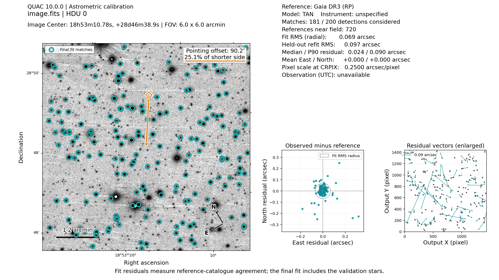

# QAC v7.12.0 — Quick Astrometry for FITS Images

<p align="center">
  
    <br>
  <em> Example of astrometry of a field with bad pointing </em>
</p>


Author: Andrea Rossi, with the assistance of ChatGPT.  
License: [MIT](LICENSE).

QAC refines image astrometry against Gaia DR3, Pan-STARRS1 DR2, 2MASS, AllWISE, UCAC5, GSC 3.3, or a local RA/Dec catalogue. Gaia DR3 remains the default. It writes a fitted TAN WCS, optionally with SIP distortion. The original pixels are retained unless `--resample` resamples them onto an undistorted TAN grid. Python 3.10+ is required.

## Install and run

Use Python 3.10+ with the requirements below. Set `RA` and `DEC` to your approximate field centre (degrees or sexagesimal), and `SCALE` to your pixel scale in arcsec/pixel.

```bash
python -m pip install -r requirements.txt
python qac.py image.fits -c "$RA" "$DEC" -ps "$SCALE"
python qac.py image.fits -c "$RA" "$DEC" -ps "$SCALE" --bad-pointing  # uncertain pointing
python qac.py image.fits -c "$RA" "$DEC" -ps "$SCALE" -p  # FITS and diagnostic PNG
python qac.py image.fits -c "$RA" "$DEC" -ps "$SCALE" --fwhm 7  # fixed stellar FWHM
python qac.py image.fits -c "$RA" "$DEC" -ps "$SCALE" --nofwhm  # skip FWHM estimation
```

Remote catalogues need internet access for uncached queries; local catalogues work offline. Run `python qac.py --help` for all options.

`-p` enables diagnostic plotting. Supply pixel scale with `-ps`, `--pixel-scale`, or `--scale`; `-p` does not take a scale value.

QAC estimates stellar FWHM in pixels from isolated, round sources, then falls back to 3 and 6 pixels if estimation or matching fails. `--fwhm PIXELS` fixes the guess; `--nofwhm` skips estimation and tries 3 then 6. Bare `--fwhm` selects the default automatic mode and should follow the image path. Each guess is detected at most once per frame. Estimation requires no angular pixel scale and does not change orientation or catalogue radius.

## Examples

```bash
python qac.py image.fits                                 # header position and scale
python qac.py image.fits -i mods -c "$RA" "$DEC"         # instrument preset
python qac.py image.fits -i bfosc -c "$RA" "$DEC"        # BFOSC preset and virtual Y flip
python qac.py image.fits --bad                           # shifted-window recovery
python qac.py image.fits --match triangle                # alternative initial matcher
python qac.py image.fits --match scamp                   # native pair-histogram FFT matcher
python qac.py image.fits --catalog stars.txt             # local RA/Dec catalogue
python qac.py image.fits --catalog gaia -b G -m 15 19    # 15 <= G < 19
python qac.py image.fits --catalog ps1 -b r -m 15 22     # PS1 mean catalogue
python qac.py image.fits --catalog 2mass -b Ks -m 10 14  # 10 <= Ks < 14
python qac.py image.fits -s aw -b W1 -m 8 16             # AllWISE
python qac.py image.fits -s uc -b G -m 8 16              # UCAC5
python qac.py image.fits -s gsc -m 12 20                 # GSC 3.3
python qac.py image.fits -f                              # try all virtual flips
python qac.py image.fits -f x -d 3                       # X flip and degree-3 SIP
python qac.py image.fits --resample                      # degree-2 SIP and rectified TAN pixels
python qac.py multi.fits -q -p                           # all frames and diagnostic pages
python qac.py multi.fits -q 5                            # only image frame 5
python qac.py multi.fits -q SCI                          # unique SCI extension
python qac.py multi.fits -i mods -q MERGED               # explicit MERGED selection
```

## Position, scale, and catalogue

`-r/--radius ARCMIN` sets a finite, positive catalogue cone radius in arcminutes around the initial field centre for each selected frame. It overrides automatic radius sizing, including instrument presets, and disables wider-radius retries. In normal mode, automatic sizing and retries retain their established behavior. It applies to Gaia, PS1, 2MASS, AllWISE, UCAC5, GSC 3.3, and spatial filtering of local catalogues. Magnitude-depth retries may still occur within the same radius; existing catalogue row limits and cache behavior still apply.

For example, `python qac.py image.fits -r 5` requests a 5-arcmin radius. Use `--resample` to resample the image.

`--bad-pointing` (alias `--bad`) tries the original centre, then north, east, south, and west centres displaced by **50% of the shorter field side**, stopping at the first accepted solution. Each trial uses the normal window: the image footprint plus **30% of the longer field side beyond every edge**. A 5′ square image therefore uses 8′ square windows. The mode is off by default and supports every catalogue provider.

Without `-r`, one original-centred catalogue cone covers all five windows. References at each magnitude depth, detections, and the stellar FWHM estimate are reused; filtering and fit validation remain unchanged. Explicit `-r` remains the exact original-centred boundary, with no enlargement or shifted queries, so a small radius can limit recovery.

Pointing reports and annotations retain the original explicit `-c` coordinates. Recovery is not guaranteed for every field or pointing error.

`--match pair` is the default initial matcher, using translation voting and star pairs. `--match triangle` instead compares triangle side-length ratios and verifies candidate transforms against the wider star list. Both reuse the same refinement, TAN/SIP fitting, clipping, and validation; triangle mode does not fall back to pair matching. It works with `--bad`, flips, FWHM retries, and explicit `-r`. Triangle candidates are bounded, and nearly collinear triangles are excluded. Comparative recovery and speed benchmarks remain pending; no new dependency is required.

`--match scamp` uses native pair-histogram FFT correlations for scale/rotation, then translation. It searches the fetched cone on a local TAN plane without the rectangular reference crop. Existing fits, validation, flips, FWHM retries and explicit `-r` remain authoritative; contrast≈2 is diagnostic only. `--scamp-sources N` and `--scamp-references N` cap initial histogram inputs (8–2000). It adds no dependency and does not run SCAMP. See [method, numerical choices and limits](SCAMP_MATCHING.md).

`-c/--coordinates RA DEC` overrides the approximate field centre. Plain numbers are degrees; sexagesimal RA uses hours and Dec uses degrees. `-ps/--pixel-scale` (also `--scale`) is the initial scale in arcseconds per pixel. Matching refines this scale. Without `-ps` or an instrument preset, a header WCS or `PIXSCALE`/`SECPIX` can supply it; otherwise QAC assumes **0.2 arcsec/pixel**, prints a prominent warning, and searches a wider scale range. Give `-ps` when you know the scale. An approximate centre is always needed.

`-i/--instrument NAME` selects an initial scale and field-size check:

| Name | Imaging mode | Scale (arcsec/pixel) | Nominal field |
| --- | --- | ---: | ---: |
| `fors` | FORS2 standard, 2×2 binning | 0.25 | 6.8′ × 6.8′ |
| `mods` | MODS imaging, 1×1 | 0.123 | 6′ × 6′ |
| `luci` | LUCI N3.75 seeing limited imaging | 0.120 | 4′ × 4′ |
| `hawki` | HAWK-I four-detector mosaic | 0.106 | 7.5′ × 7.5′ |
| `bfosc` | Loiano BFOSC imaging, 1×1; default Y flip | 0.57 | about 13′ × 12.6′ |
| `lbc` | LBT LBC Blue or Red, 1×1 | 0.225 | 23′ × 25′ full camera |
| `gmos` | Gemini GMOS-N or GMOS-S imaging, 2×2 | 0.160 | 5.5′ × 5.5′ |
| `sifapsoft` | SIFAPSOFT imaging, 1×1 | 0.067 | about 10′ |
| `nics` | TNG NICS imaging, 1×1 | 0.25 | about 4.3′ |

Scale priority is **explicit `-ps` > selected instrument preset > valid header WCS > `PIXSCALE`/`SECPIX` > 0.2 arcsec/pixel fallback**. Every `-i` preset overrides header scales for every selected image frame, including with `-q`. At 1×1 binning, `-i mods` supplies the same starting scale as `-ps 0.123`. A usable header WCS still provides orientation and pointing while its scale is rescaled; `-c` overrides its centre. BFOSC additionally defaults to the virtual Y flip; explicit `-f` takes priority. The matched stars refine the final scale, so a preset or `-ps` is a starting guess rather than a fixed constraint.

Recorded binning adjusts preset scales relative to the reference binning in the table. Invalid or unequal X/Y binning requires an explicit `-ps`, which is used as supplied and bypasses preset binning adjustments. For a different camera mode or older detector, supply its measured scale with `-ps`.

The preset values are based on the [ESO FORS2](https://ftp.eso.org/pub/dfs/pipelines/instruments/fors/fors-img-reflex-tutorial-2.0.pdf), [LBTO MODS](https://scienceops.lbto.org/mods/) / [LUCI](https://www.lbto.org/instruments-overview/), [ESO HAWK-I](https://eso.org/sci/facilities/paranal/instruments/hawki.html), [LBC](https://www.lbto.org/instruments-overview/), [Gemini GMOS](https://www2.gemini.edu/instrumentation/gmos/observation-preparation), and [BFOSC](https://www.oas.inaf.it/wp-content/uploads/2019/05/BFOSC_en_UM_2001.pdf) documentation. SIFAPSOFT and NICS use the scale and approximate field sizes supplied for this release. BFOSC's manual quotes 0.58″/pixel; the preset uses the requested 0.57″/pixel. The MODS preset uses one value for both channels.

When a valid input WCS and header pointing (`RA`/`DEC` or `OBJRA`/`OBJDEC`) disagree by more than 1 arcmin or a quarter of the image's half-diagonal, QAC warns with the separation. It still starts from the input WCS; use `-c RA DEC` to override its centre. Linear TAN solutions also report a held-out RMS: QAC refits using 80% of the matched stars, checks predictions for the other 20%, and rejects a solution whose held-out error is too large. SIP fits retain their separate held-out validation.

For LBC, each CCD covers about 7.8′ × 17.6′. Use the same preset for one CCD or the full camera: the image dimensions, not the nominal field in the table, determine the catalogue search. Select a CCD in a multi-extension file with `-q N` or `-q EXTNAME`. For GMOS, 1×1 binning gives a starting scale of 0.080″/pixel when recorded in the header. Use a processed GMOS image or mosaic; raw amplifier extensions contain overscan and are not independent sky frames.

In normal mode, `-i` starts with a smaller catalogue cone around the footprint computed from the image dimensions and initial scale. If the match fails, it retries the wider search. The nominal field is a sanity check, not a limit on cropped, mosaicked, or offset images. HAWK-I's 7.5′ field covers all four detectors; each individual detector covers a smaller footprint, and multi-extension files need `-q`. A failed archive request or catalogue row cap is reported directly rather than repeated over a larger area.

The default catalogue is Gaia DR3 in RP with **12 ≤ RP < 20**. `-s/--survey` (also `--catalog`) selects Gaia DR3, PS1 DR2, 2MASS, AllWISE, UCAC5, GSC 3.3, or a local RA/Dec text file. `-s ps1` (or `-s ps`) uses PS1 DR2 mean astrometry and r-band mean PSF magnitude with **15 ≤ r < 21** by default; `-b` accepts g/r/i/z/y. `-s 2mass` uses J with **12 ≤ J < 15.8** by default; H and Ks default to faint limits of 15.1 and 14.3. `-s allwise` (or `-s aw`) defaults to **8 ≤ W1 < 16**. `-s ucac5` (or `-s uc`) defaults to **8 ≤ G < 16**. `-s gsc3.3` (or `-s gsc`) defaults to **12 ≤ mag < 20**. `-m FAINT` changes only the faint limit, retaining that catalogue/band's default bright cut; `-m BRIGHT FAINT` changes both. Bounds are inclusive at the bright end and exclusive at the faint end. The limits are selection cuts, not completeness guarantees.

AllWISE `-b` accepts W1/W2/W3/W4, with default ranges of 8–16, 7–15, 4–11, and 0–8 respectively. UCAC5 `-b` accepts G/R/J/H/Ks; its default bright limit is 8 in all bands, with faint limits of 16, 16, 15.8, 15.1, and 14.3. Gaia G/BP/RP, PS1 g/r/i/z/y, and 2MASS J/H/Ks band selection is unchanged; `K` is also accepted for `Ks`.

AllWISE queries [VizieR II/328/allwise](https://cdsarc.cds.unistra.fr/viz-bin/ReadMe/II/328?format=html&tex=true). It uses the recommended stationary `RAJ2000`/`DEJ2000` positions, not the motion-fit positions. Astrometric references require quality A in W1 and the selected band, no flagged artifacts or saturated pixels in those bands, no extended-source flag, one fitted component, no active deblending, and a finite error-ellipse semi-major axis of at most 0.3 arcsec. The [AllWISE apparent motions mix proper motion and parallax](https://irsa.ipac.caltech.edu/data/WISE/docs/release/AllWISE/expsup/sec2_1.html), so QAC does not propagate them to the observing date. Optical/infrared source differences, blending, and uncorrected stellar motion can limit agreement with an optical image.

UCAC5 queries [VizieR I/340/ucac5](https://cdsarc.cds.unistra.fr/viz-bin/ReadMe/I/340?format=html&tex=true), using its Gaia DR1 `RAgaia`/`DEgaia` positions at J2015.0 and `pmRA`/`pmDE` in mas/year (`pmRA` includes cos(Dec)). These differ from the older UCAC-epoch positions. With `DATE-OBS` or `MJD-OBS`, QAC propagates usable proper motions and rejects rows with missing motions. Without a date it keeps J2015.0 positions and prints a warning. Formal Gaia coordinate errors must be finite and at most 300 mas per axis; proper-motion errors must be finite and at most 10 mas/year per axis. Missing-photometry placeholders 0 and 30 in R/J/H/Ks are rejected. These are quality cuts, not a full propagated covariance or fit weights; parallax and unmodeled systematics remain limitations.

GSC 3.3 queries the [MAST Guide Star Catalog service](https://outerspace.stsci.edu/spaces/MASTDATA/pages/176435487/Catalog+Access) with `CATALOG=GSC33` and accepts only rows classified as stars (`classification=0`) with finite coordinates and `mag`. The default cut is **12 ≤ mag < 20**; `-m` changes it. The service's `mag` is a preferred magnitude from potentially different passbands, so brightness ordering and cuts are approximate across sources; `-b` is unavailable. When an observation date exists, QAC requests coordinates at that epoch from MAST. QAC requests GSC33 explicitly, checks the CSV count and columns, and rejects responses that name a different GSC release. Queries reaching the 10,000-row cap are rejected; use `-m` or `-r` to narrow them.

AllWISE, UCAC5, and 2MASS share VizieR transport and reject responses reaching the 10,000-row limit. Narrow `-m` or `-r` for dense fields. Cone searches select sources at their catalogue positions before any epoch propagation; very high proper-motion sources can cross a cone boundary between epochs.

PS1 queries the [MAST DR2 mean catalogue](https://catalogs.mast.stsci.edu/docs/panstarrs.html) using `raMean`/`decMean` positions corrected against [Gaia EDR3](https://archive.stsci.edu/contents/newsletters/july-2022/updated-astrometry-for-the-pan-starrs1-catalog). It accepts sources with the corrected-astrometry flag, at least three detections, the GOOD quality bit and no extended-source bit, band coverage, and suitable photometric and positional errors. The current limits are band `QfPerfect ≥ 0.85`, mean PSF magnitude error ≤ 0.3 mag, and each mean coordinate error ≤ 0.3 arcsec. With `DATE-OBS` or `MJD-OBS`, reliable [PS1 proper motions](https://outerspace.stsci.edu/spaces/PANSTARRS/pages/298812412/PS1%2BObjectThin%2Btable%2Bfields) are propagated from `epochMean` (MJD); `pmra` and `pmdec` are in mas/year, with `pmra` interpreted as μRA cos(Dec). QAC requires the PM flag, no bad-PM flag, errors ≤ 2 mas/year on each axis, and propagation uncertainty ≤ 0.1 arcsec. Sources lacking a usable motion or observation date retain `raMean`/`decMean`.

At r≈22, some PS1 detections exist only in the [stack catalogue](https://catalogs.mast.stsci.edu/docs/panstarrs.html). Their `raStack`/`decStack` positions do not have the same Gaia EDR3 correction and can have larger systematic errors than corrected mean positions; several faint stack rows also have missing point-source diagnostics. QAC deliberately excludes stack-only and uncorrected mean sources, so `-m 15 22` is a magnitude *ceiling*, not a promise of complete reference coverage to r=22. A future stack-only mode would need separate uncertainty weighting and validation against corrected mean stars; it cannot be pooled into the current fit as equally precise references.

Gaia initially queries to magnitude 18.5 and extends to 20 for sparse or weak matches. Dense automatic queries narrow the faint limit to avoid the archive's 2,000-row synchronous cap; an explicit range that reaches the cap produces an error. QAC matches the brightest catalogue stars first, then tries progressively fainter groups and refits using all accepted matches. PS1 and AllWISE matching consider up to 200 image detections during initial matching because usable references can rank below brighter detections in the image. Gaia results are cached in `~/.cache/qac` (or `$XDG_CACHE_HOME/qac`); `--refresh-catalog` bypasses that cache and affects only Gaia. The other remote catalogues retain their existing Astroquery/service cache behavior and per-run reuse; UCAC5 reused positions are keyed by observation date. Gaia proper motions are propagated from J2016.0 to `DATE-OBS` or `MJD-OBS` when available. AllWISE, 2MASS, and local positions are not propagated.

A local text catalogue contains `RA DEC [MAG]` on each line, separated by spaces or commas. A `RA DEC` header and `#` comments are allowed. Coordinates may be decimal degrees or colon-separated sexagesimal (RA in hours). Synthetic example coordinates:

```text
RA DEC MAG
188.733750 31.739444 15.2
12:34:57.10 +31:44:19.0 16.1
```

## Flip, distortion, and resampling

`-f/--flip x`, `y`, or `xy` tries that virtual reversal. Bare `-f` tries normal and all three reversals, selecting the best match. The saved WCS refers to the **original pixel layout**.

For BFOSC the default Y flip is virtual: QAC writes the fitted WCS against the original image pixels.

Without `-d`, QAC fits a linear TAN WCS. Bare `-d/--distortion` fits degree-2 SIP; `-d 3` fits degree 3. The legacy spelling `--distorsion` remains an alias. SIP is fitted in detector pixels after the initial match. Degree 2 requires at least 25 well-spread stars, degree 3 at least 40; held-out stars validate the fit. An unsuccessful explicit SIP fit marks that frame as failed; other selected frames are still attempted. A single-frame failure, or a run in which every selected frame fails, writes no output.

`--resample` implies degree-2 SIP unless `-d 3` is given. It maps pixels by bilinear interpolation onto a same-size TAN grid and applies a local pixel-area correction for count-per-pixel images. Blank or uncovered pixels become NaN; output pixels are floating point. Interpolation changes sharp features and noise, and the fixed-size grid can lose a narrow edge strip. The area correction is inappropriate for surface-brightness-per-solid-angle images: use a SIP-header output instead.

## FITS output and frames

One 2-D image is solved directly, including an image extension behind an empty primary HDU. Multiple images or a 3-D stack require `-q/--cube`, except that `-i mods` automatically selects a uniquely named `MERGED` image when no `-q` was supplied. Current Archon MODS files contain four raw image extensions (`IM1`–`IM4`), a status table, and `MERGED` in HDU 6: QAC calls `MERGED` **image frame 5** and writes only that frame. If there is no unique `MERGED` image, give `-q` explicitly; the instrument option never guesses from the extension number.

Bare `-q` solves all image frames; for a stack, it writes independent 2-D extensions. `-q N` solves **only** 1-based image frame N and writes one standalone 2-D primary image; empty and table HDUs are skipped in the count. `-q EXTNAME` selects a uniquely named image extension. Any explicit `-q` overrides MODS automatic selection. A selected plane is also written as one standalone image.

The default file is `INPUT_astro.fits`, or `INPUT_resampled.fits` with `--resample`; a single selected frame inserts `_qN`, for example `INPUT_q5_astro.fits`. `-o PATH` chooses an output path and `--overwrite` permits replacing an existing output file. The input itself is never overwritten. QAC attempts every selected frame, continuing after expected source-detection, catalogue, matching, fitting, or resampling failures. If at least one frame succeeds, it stages the output FITS and any requested PNG pages, then publishes them after writing and rendering succeed. All selected readable images remain in the output: successful frames receive their new WCS, while failed frames retain their input pixels and unverified input WCS. Per-frame match counts, RMS, fitted scales, and failure reasons are printed.

Every selected image has `QACSTAT = SOLVED` or `FAILED`, `QACVER`, and `QACRSMP` (whether its pixels were resampled in this run). Failed frames also have `QACERR`; old failure messages are removed from successful frames. Check `QACSTAT` before using a frame's WCS as a QAC calibration. The primary header summarizes the run with `QACRUN = COMPLETE` or `PARTIAL`, `QACNSEL` (selected), `QACNSOL` (solved), and `QACNFAI` (failed). With `--resample`, successful frames are rectified but failed frames retain their native pixels, even in an output named `_resampled.fits`; `QACRSMP` distinguishes them.

Exit status is **0** for complete success, **1** for a saved partial result, and **2** when no frames solve or a handled input/output/rendering error prevents saving the requested result. Partial completion prints `PARTIAL SUCCESS: N/T frames solved`. No output is published if all selected frames fail. Unreadable input data that cannot be preserved, invalid common options, and output writing/rendering failures remain fatal.

For successfully solved images, the fitted sky mapping is stored in `CRVAL1/2`, `CRPIX1/2`, `CTYPE1/2` and **CD1_1, CD1_2, CD2_1, CD2_2**; SIP coefficients are included when `-d` is used without `--resample`. Old primary and alternate WCS terms, lookup distortions, SIP metadata, and IRAF WCS descriptors are removed from solved headers. Solved headers have no `PC`, `CDELT`, or `CROTA` cards. Existing `PIXSCALE` and `SECPIX` cards are updated at `CRPIX`. Pointing metadata such as `RA`/`DEC` and `OBJRA`/`OBJDEC` is kept; it is not the fitted WCS. IRAF detector coordinates (`LTV`/`LTM`) are kept when pixels are unchanged and removed for extracted stack planes or resampled images.

## Diagnostic PNG

Add `-p/--plot` to save PNG diagnostics beside the calibrated FITS file: `image_astro.fits` produces `image_astro.png`. A single selected frame uses a 2560 × 1440 layout. Multiple frames share a figure with up to six frames per page; longer selections use `image_astro_page1.png`, `image_astro_page2.png`, and so on. Original 1-based image-frame numbers remain visible. MODS quadrants form a 2×2 grid beside the larger merged image.

- **Field:** inverted grayscale, cyan rings around final fit matches, thicker gold rings around the ten brightest usable detections, compass arrows, and an angular scale bar. Bright detections need not be catalogue matches. Auto cuts use the 1st/99.5th percentiles and sigma-clipped sky statistics, with an asinh stretch (`a = 0.08`) targeting a roughly 75% white sky.
- **Quality:** catalogue/band, TAN/SIP model, matched/detected/reference counts, fit RMS, held-out RMS, median and 90th-percentile residuals, mean East/North offsets, pixel scale, and observation time. A single-frame figure includes East/North residual scatter and a spatial residual-vector map; combined figures use colour-coded scatter and per-frame fit/validation RMS bars.
- **Failures:** red borders, a `FAILED` label, and a shortened reason; failed frames use pixel axes without calibration overlays. They remain visible but contribute no residuals or RMS bars. Full reasons appear in the console and FITS `QACERR`. Pages containing only failures are retained if another page has a solved frame.

Explicit `-q` displays successful fields north up and east left; other single-frame views retain the output pixel grid. Display reprojection uses bilinear interpolation and blank pixels outside the footprint. Overlays follow the displayed grid; FITS pixels, fitted WCS, residuals, and original-field pointing percentages are unchanged.

With explicit `-c RA DEC`, every solved frame reports the requested-to-solved centre offset in the console, even without plotting. PNGs show an orange diamond at the request and an arrow toward the centre; off-field arrows start at the field boundary. Labels show `Pointing offset: X.x″` and `X% of shorter side`, underlined in orange above 5%. The percentage uses angular edge-midpoint spans before display reorientation. Header-derived coordinates and failed frames receive no pointing annotation.

Residuals are observed minus reference in arcseconds. Radial RMS is the square root of the mean squared angular separation; held-out RMS comes from validation, while the final fit uses all accepted matches. Frames are assessed independently. These statistics measure reference-catalogue agreement, not absolute positional accuracy.

Plots reuse accepted matches without another catalogue query or fit. PNG creation works without a graphical display. At least one frame must solve and all requested pages must render before publication; `--overwrite` covers every output, but replacing multiple files is not one filesystem transaction.

After publication, QAC tries to open each PNG using `xdg-open` (Linux), `open` (macOS), or the Windows file handler without waiting for the viewer to close. A graphical session and configured viewer are needed to see a window; opener failures leave saved files and calibration exit status intact.

## Limits

The matcher needs enough reference stars near a trial field. With a supplied scale it allows roughly 25% initial **pixel-scale mismatch**, not a 25% pointing-error limit; the 0.2″/pixel fallback searches a wider scale range. Source detection uses a 5-sigma threshold. Sparse, blended, or nonstellar fields can prevent reliable FWHM estimation; crowded, saturated, nebulous, or strongly distorted images may require other tools.

## Checks

Run the offline CLI checks with `python -m unittest discover -s tests -p 'test_cli_options.py'`. The complete offline regression and plotting suite also requires `pytest` and can be run with `python -m pytest tests`.
